# How a C file becomes a hex file

This page traces your C program through the epic-cc compiler to the hex file, for a hobbyist who finished [Getting started](../getting-started/index.md) and wants to know what one compiler invocation does with their code.

## One command, many stages

You compile with a single command that names the part and the output: `epic-cc --target p16f877a` turns your C files into a hex file, with no separate assembler or linker to install. The compiler ships its own clang, so the C front end travels with the release. Every flag the command accepts is listed in the [CLI flags reference](../compiler/cli-flags.md), and every part it accepts is listed in the [device matrix](../devices/index.md).

Inside that one command, your program passes through a chain of stages. Each stage has a diffable text boundary, so any failure points at the stage that broke instead of the whole chain. The diagram below follows a program from source to hex file; the sections after it explain what each group of stages does and why.

```mermaid
graph LR
  c[Your C files] --> clang[Clang front end<br/>one IR file per source]
  clang --> merge[Whole-program merge<br/>one module, library calls resolved]
  merge --> legal[Legalize and call graph<br/>wide operations expanded,<br/>recursion rejected, stack checked]
  legal --> alloc[Allocate<br/>variables placed in RAM]
  alloc --> isel[Instruction select<br/>one backend per core]
  isel --> banks[Banking or outlining<br/>memory windows handled]
  banks --> asm[Internal assembler<br/>words checked against flash size]
  asm --> hex[Hex file<br/>program plus configuration words]
```

## From C to one program

The front end compiles each C file to intermediate representation, the compiler's portable working language, using fixed settings chosen for small PIC parts. A merge step then joins those files into one whole program in command-line order and runs a curated set of optimizations over the result. From here on the compiler sees your entire program at once, which is what lets later stages share random-access memory (RAM) between functions that never run at the same time.

The next two stages adapt that whole program to hardware without an operating system behind it. Legalization expands operations the chip cannot run directly, such as wider arithmetic and floating point, into sequences of byte operations and runtime calls. The call graph builder then maps every caller to every callee, rejects recursion with an error, and checks the deepest call chain against the part's hardware stack. There is no addressable stack to fall back on, so a recursive program cannot run: the compiler stops and names the cycle instead of writing a hex file that would crash.

## From program to words

Allocation places every global and local variable at a fixed RAM address, reusing addresses for functions that cannot be live together. Instruction selection then translates the program into machine instructions with one backend per core: PIC12 baseline, PIC14 (mid-range), PIC14E (enhanced mid-range), and PIC18 each have their own.

The memory windows of the smaller cores need one more pass. PIC14 and PIC14E programs address RAM in banks and flash in pages, so the compiler inserts the bank selections each access needs and cleans up the redundant ones, while page selections for flash are emitted with the instructions and cleaned up the same way. PIC18 carries its addressing in the instruction itself, so it skips that pass and instead factors repeated instruction runs into shared subroutines to save flash. An internal two-pass assembler then turns the instructions into words and refuses programs that overflow the part's flash.

The last step writes the Intel hex file: the program words, an end marker, and the configuration words spliced in alongside the code. Your build supplies those configuration values, as [how the HAL is structured](hal-structure.md) explains, and the compiler reports every field's value in its build report. The file that comes out is the artifact everything downstream consumes: the [simulator](simulator.md) loads it, and the programmer writes it to the chip.

## The trade-offs you feel

Three compiler decisions surface in everyday code.

First, recursion and unbounded call depth are errors, not warnings. Size the call chains in interrupt handlers with this in mind, and keep interrupt work short.

Second, optimization profiles trade flash against speed around a size-first default. The default profile keeps programs small; a fold-only profile suits stepping through code and bisecting failures; higher profiles trade flash for speed by inlining and running faster instruction sequences. Name the profile on the command line when the default is not what an example needs; every flag the command accepts is listed in the [CLI flags reference](../compiler/cli-flags.md).

Third, the compiler favors refusing over guessing. An unsupported language feature, a recursion cycle, or a program larger than flash stops the build with a named error. When a build stops, the stage artifacts (`--emit` shows one stage as text, `--save-temps` keeps them all) show where your program crossed the line, and the symbol map shows where every variable landed.

!!! note
    Compiler errors name the problem instead of writing a wrong hex file. Read the error first: it usually points at the construct to rewrite, not at a flag to add.
