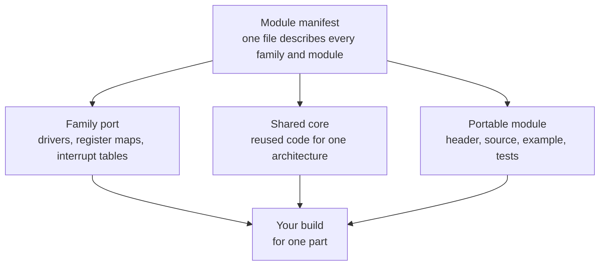

# How the HAL is structured

This page shows you how epic-hal, the hardware abstraction layer (HAL), organizes its code by family and by module, for a hobbyist who finished [Getting started](../getting-started/index.md) and wants to understand what a family port owns versus what a portable module owns.

## Families, ports, and parts

A port owns everything that differs between families: the per-peripheral drivers, the register map of each part, the interrupt tables and dispatch, and the startup code.

Ports that share a core also share one core implementation instead of duplicating it. The PIC14 ports reuse the shared code under `hal/pic14/core`, while the PIC12 baseline port keeps its own core because its architecture differs too much to share.

The diagram below shows how a family port relates to the shared pieces around it. You never include port files directly: the build reads the manifest and picks them for you.

## Modules and the manifest

A HAL module is one reusable capability, such as the timebase in `lib/tick` or the serial port in `lib/serial`. Each module owns its public header, its source, an example that CI builds and runs, its API documentation, and its tests. Some modules also carry a per-family backend for the pieces that touch registers.

One manifest file describes every family and every module: which sources and include paths each family needs, which modules depend on which others, and which parts each module supports. Three consumers read it and nothing else encodes that knowledge: the build driver, the CI matrix that builds every module for every part, and the release bundler. Because the knowledge lives in one place, adding a family or a module means adding one entry, and every index and matrix picks it up without further edits.

When you name a module and a part in a build command, the driver resolves the module's dependencies from the manifest, selects the family port for your part, and compiles exactly that set. The supported families for each module are listed in the [HAL module reference](../hal/index.md), and your part's family is listed in the [device matrix](../devices/index.md).

## The toolchain-neutral contract

The same HAL source builds under two compilers: epic-cc on the default path, and MPLAB XC8 as the alternate. The manifest keeps one file list per toolchain for each family, and the build driver selects the right slice. Only the smallest machine-specific pieces differ between toolchains: the interrupt vectors, the dispatch shims, and the sleep and watchdog helpers. Everything above that layer, including every portable module, is identical source on both paths.

This contract shapes how configuration works. Your build carries the chip's configuration words alongside the code: the oscillator mode, the watchdog setting, and the clock frequency default each family declares. On the epic-cc path you override them through the `EPIC_CONFIG` mechanism the platform header provides; on the XC8 path the same values travel as configuration pragmas. Either way the generated hex file contains both the program and its configuration, so the [simulator](simulator.md) and the programmer consume the same artifact.

!!! note
    The two toolchains must agree byte for byte on shared builds, so the order of the driver's compiler flags is load-bearing. If you wrap the driver in your own scripts, forward its flags unchanged.
