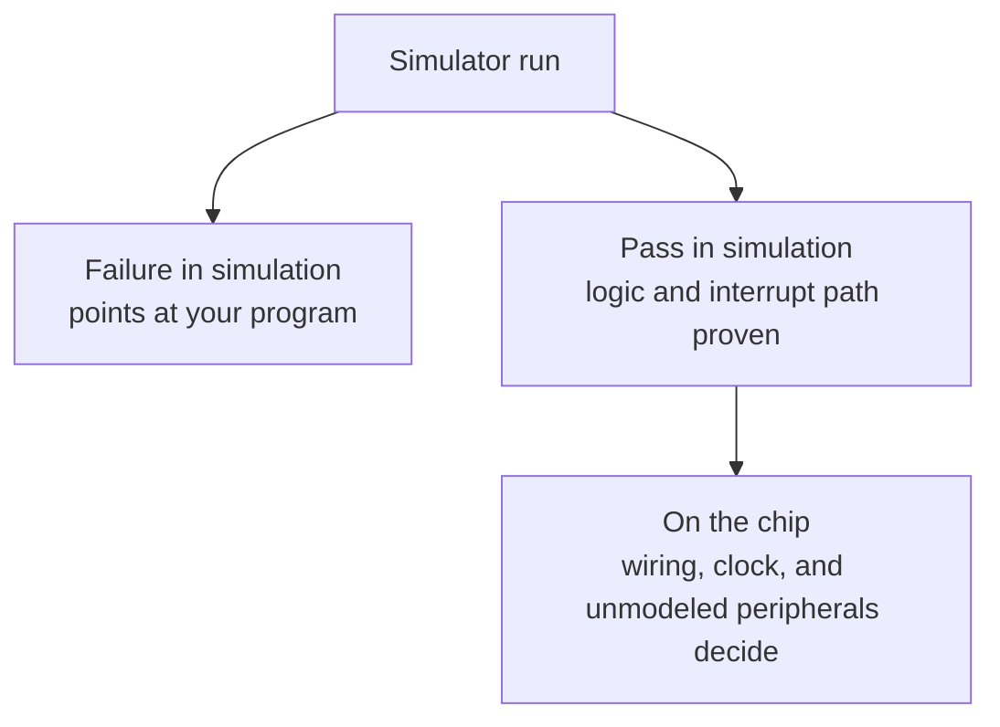

# What the simulator proves

This page explains what the epic8 simulators model and what a passing run tells you, for a hobbyist who finished [Getting started](../getting-started/index.md) and wants to know how much trust a simulator result carries.

## Two simulators, one for each path

The difference is what surrounds the processor model. MPLAB SIM models some peripherals: on the families its models cover, a timer advances as the program steps, and port reads reflect output latches the way silicon presents them (on PIC16 families; on PIC18 read the latch register, `LATA`, not `PORTx`). The epic-cc simulator models the processor and its registers but not the peripherals or the oscillator. Where a test needs a timer interrupt, the runner raises the interrupt itself on a step schedule, through the same flag and enable bits the peripheral would use.

## What a passing run means

A simulator run watches one register bit across step-counted samples and requires it to change. In the blinking example from the tutorials, the runner samples bit 0 of `PORTB` over a fixed number of steps and prints a `PASS` line naming the bit, the sample count, and the step count. Other gates use the same contract for other modes: a serial test passes when the captured output holds the expected marker, and a port test passes when the watched bit reads set after the run.

This contract proves your program logic and your interrupt path. The timer interrupt in the blinking example fires because the runner raised its flag, the firmware's handler ran, the tick counter advanced, and the output bit toggled. If any link in that chain broke, the bit would hold still and the run would fail. The firmware counts interrupts rather than clock cycles, which is exactly what makes this honest: the gate proves the interrupt path, never a timing figure.

## What simulation cannot prove

- Peripherals the model does not carry stay silent. Serial receive, analog input, and electrically erasable programmable read-only memory (EEPROM) writes behave differently from silicon or need debugger assistance, depending on the simulator. Module pages document these limits where they apply.

- Timing figures come from interrupts you count, not from a clock the simulator models. The simulator has no oscillator, so it cannot tell you how fast your chip runs.
- Real hardware adds the board. The crystal value, the supply, the wiring, and the configuration words decide whether a passing program blinks on your bench. Flashing is tested in simulation and awaits sign-off on real chips; see [What's in 1.0](../status.md).

Treat the simulators as a filter with a clear division of labor. A failure in simulation points at your program: the logic, the interrupt setup, or the configuration. A program that passes in simulation but misbehaves on the chip points everywhere else: the wiring, the clock source, the programmer settings, or a peripheral the simulator never modeled. That ordering is the whole point of simulating first with no hardware.

The diagram below shows where to look when each stage fails.

!!! tip
    When a gate fails, rerun it with tracing enabled before changing code. The trace prints register values per sample, so you see whether the flag latched and the handler serviced it instead of guessing at it.
