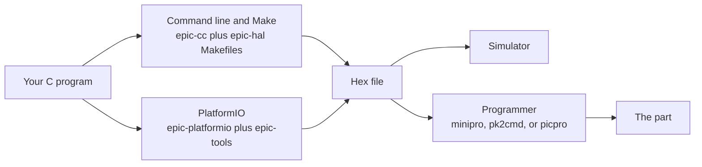

# How the toolchain fits together

This page shows you what each epic8 repository owns and how the pieces connect, for a hobbyist who finished [Getting started](../getting-started/index.md) and wonders where one tool ends and the next begins.

## The four repositories

epic8 is a family of four repositories under one licence. Each one owns a distinct layer, and each layer links down to the next instead of repeating it.

| Repository | What it owns |
|---|---|
| [epic-cc](https://github.com/apojomovsky/epic-cc) | The C compiler: it turns your C files into a hex file in one command, with its own bundled clang, so you install nothing else to compile. |
| [epic-hal](https://github.com/apojomovsky/epic-hal) | The hardware abstraction layer: a register-level port per family plus drop-in modules for the things firmware always needs, such as a scheduler, a timebase, and serial ports. The same code builds under epic-cc and under MPLAB XC8. |
| [epic-platformio](https://github.com/apojomovsky/epic-platformio) | The PlatformIO platform: it makes `pio run` compile with epic-cc and wires in epic-hal as an optional framework. MPLAB XC8 stays available as a fully supported alternate toolchain. |
| [epic-tools](https://github.com/apojomovsky/epic-tools) | The programmer tool packages: it turns each flashing tool into a PlatformIO tool package, so upload resolves the right binary for your machine without you building anything. |

The diagram below traces a program from your source to the chip. You pick one of the two build paths, both produce the same hex file, and that file either runs in the simulator or goes onto the part through a programmer.

## Why two build paths exist

The command line path keeps every step visible: you invoke the compiler, you invoke `make`, you see each command and its output. The PlatformIO path hides that machinery behind `pio run` and gives you boards, dependencies, and upload in one project file. Both consume the same compiler and the same hardware abstraction layer (HAL), so a program that builds on one builds on the other, and the [tutorials](../getting-started/index.md) teach both from the same blinking example.

This split is a deliberate layering rule. The epic-cc and epic-hal pages stay toolchain-neutral: they assume the command line and Make only, never PlatformIO. The epic-platformio pages form the complete PlatformIO path end to end and link back to the compiler and HAL reference pages for depth instead of copying them. The only link in the other direction is the shared [Ways to use epic8](../index.md) include, rendered on the home page and every README, which sends each reader to the path that fits how they work.

## Where each question is answered

When you know which layer owns your question, you know which pages to read.

- Which parts and cores the compiler accepts: the [device matrix](../devices/index.md).
- What a compiler flag does: the [CLI flags reference](../compiler/cli-flags.md).
- What a HAL module offers and which families it supports: the [HAL module reference](../hal/index.md).
- Which board to name in `platformio.ini` and how upload works: the [PlatformIO pages](../platformio/index.md) and the [boards list](../platformio/boards.md).
- Which programmer tools exist and how they connect: the [programmers page](../tools/programmers.md).
- Whether a feature is supported, experimental, or planned: [What's in 1.0](../status.md).

If your question is about the inside of one layer rather than the boundary between layers, the companion pages cover it: [how the HAL is structured](hal-structure.md), [what the simulator proves](simulator.md), and [how a C file becomes a hex file](c-to-hex.md).
